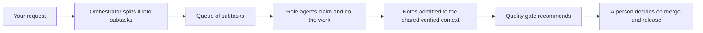

# How grugops works

This page follows one request through grugops, from the moment you type it to the point where a person decides whether to merge and release the change. Each section names the role or workflow file that does the work, so you can read the rule itself. For the ideas behind these steps, see [The core concept](concepts.md).

## The flow at a glance

The same steps as text:

1. You give grugops a request through your coding-agent CLI.
2. The Orchestrator reads the config, the board and the published notes, and splits the request into subtasks.
3. Each subtask goes on a queue, and the Orchestrator claims it for a role agent just before that agent starts.
4. The role agent reads the shared verified context, does its one job, and publishes typed notes back into it.
5. The quality gate runs its checks, renders the trace from the notes and returns a recommendation.
6. A person reviews the pull request and decides whether to merge and release it.

## You make a request

You start grugops from the coding-agent CLI you already use and say what you want in plain words. The [grugops skill page](reference/skills/grugops.md) shows what to type on each host.

<!-- claim: C-28-048 -->
Every request goes to the Orchestrator first. Its role file says so in one line: any incoming request activates it.

## The Orchestrator splits the request

The [Orchestrator](reference/agents/orchestrator.md) reads the config first, because the config decides which gates are live. It then reads the board and the published notes; a started ticket outranks a new one. It classifies the request, splits it into subtasks, and routes each subtask to the role whose one job fits it: product questions to BA/PM, code to the Software Engineer, tests to QE/E2E, and so on. It draws on the roles the work needs and skips the rest.

<!-- claim: C-28-049 -->
The Orchestrator's role file tells it never to do a task's work itself. On a host where it can start other agents, it hands each subtask to a role agent. On a host where it cannot, it switches into the role first, by the [role-switch protocol](../agent-factory/roles/_role-switch-protocol.md), and does the work as that role.

## The queue and claims

The queue is a set of folders on disk, run by [Workflow 17](../agent-factory/workflows/17-task-claim.md). Each subtask starts as a two-line file under `pending/` that names its context folder. Before it starts a role agent, the Orchestrator runs `node tools/grugops/claim.js free`, which prints how many more agents may run: `queue.wip_limit` minus the claims on disk. It then claims the subtask in the role's name with `claim.js claim`. That moves the subtask to `claimed/` and rewrites `now-running.md`, the list of work in progress.

<!-- claim: C-28-050 -->
A claim is atomic: when two claims race for one subtask, one wins, the other prints a `lost` line, and the Orchestrator takes the next task. When the role finishes, `claim.js done` moves the subtask to `done/`, and it refuses while the task's context folder holds no sealed note written since the claim.

On a host with a spawn tool, the Orchestrator starts each claimed role as its own agent, up to `queue.wip_limit` at a time. On other hosts it loads the roles one at a time. See [Open gaps](#open-gaps) for what is not yet proven on a live run.

## Role agents publish notes

<!-- claim: C-28-051 -->
A role agent starts by reading the shared verified context for its task with `node tools/grugops/note.js read <folder>`, which prints each sealed note in full ([Workflow 16](../agent-factory/workflows/16-context-read-write.md)). It does its one job, then records what it found with `note.js add`, the host copy of `context-io`, the one sanctioned writer of the shared context. A note written any other way, by an editor, a file-writing tool or a heredoc, is refused on read as `unsealed`. A `finding`, a verified result, is admitted only with a real stamp: a green gate verdict or a named human. A softer result goes in as a `claim` or an `observation`, and an unverified one carries `confidence: UNKNOWN - verify`. Roles do not pass data to each other: the next role reads what the last one published.

## The gate recommends

<!-- claim: C-28-052 -->
Before a ticket advances, the Orchestrator runs the [PR quality gate](../agent-factory/workflows/05-pr-quality-gate.md). It first runs a read-only check of the git host's branch protection, then install, lint, typecheck, unit tests, build and the end-to-end checks the config turns on, then a test-integrity check on skipped tests. When a check fails, the agent gets a small, fixed number of self-fix attempts (`self_fix_attempts`, two by default), then stops and hands the problem to a person. The gate ends in exactly one result: `READY_FOR_HUMAN_REVIEW`, `BLOCKED_NEEDS_FIX` or `SPLIT_REQUIRED`. That result is a recommendation. The gate itself never merges: its last step hands the change to a person.

## The trace

The gate also runs `node tools/grugops/trace-render.js .`. It renders one trace file per ticket under `memory-bank/plans/traceability/` from the refs on published notes, linking each requirement to its ticket, code, tests, UAT and release, plus a one-line-per-ticket index at `memory-bank/plans/traceability.md`. The gate commits the rendered files on the pull request branch, so a reviewer reads the trace next to the change.

## The release

A release follows [Workflow 12](../agent-factory/workflows/12-release.md), run by the [Release Manager](reference/agents/release-manager.md). It sets the version, compiles the changelog and release notes from the included tickets, confirms the migration, rollback and recovery plans, attaches the NFR, security and compliance evidence, and walks the release-readiness checklist.

<!-- claim: C-28-053 -->
Step 6 is the human step, and it is keyed to the `production_requires_human_confirmation` checkpoint. At that checkpoint's default, the workflow records a named person's approval, runs the read-only git-host check, and waits for a named person to confirm the production action. [GUARANTEES.md](GUARANTEES.md) shows where that checkpoint is held in the grugops source checkout at its default settings. Your own setting is in `.grugops/factory.config.json`.

## A person merges and deploys

<!-- claim: C-28-054 -->
The workflows and role files tell agents to stop at a pull request and to leave merge and deploy to people. That is written text, and it holds only as well as an agent follows it. What stops a merge or a deploy mechanically is set on your git host: branch protection or rulesets on protected branches, and deployment environments with required reviewers for production. That is the hard floor, and for a deploy it holds only when the deploy credentials live solely in the production environment's secrets. On Claude Code, the standalone installer also writes ask rules, so the CLI asks before the usual merge and deploy commands; they are a speed bump, not a security boundary. [GUARANTEES.md](GUARANTEES.md) shows which safety claims hold in the grugops source checkout at its default settings. Your own floors are set in `.grugops/factory.config.json`.

## How work flows

<!-- claim: C-28-033 -->
- **The board** — `memory-bank/plans/board.md` is the visible state of the factory: WIP-limited columns
  that every ticket moves through, from Ready to Done (or to Ready to Release in enterprise
  mode). The board *is* the state; the column an item sits in is its status.
- **Traceability** — the audit trail, rendered per ticket from published note refs. Each ticket's
  file under `memory-bank/plans/traceability/` links requirement → ticket → code → test → UAT →
  release, and `memory-bank/plans/traceability.md` indexes them one line per ticket, so each
  shipped change leaves a trail from requirement to release.
- **The lifecycle** — the Orchestrator decomposes each request into subtasks and enqueues
  them for whichever stages the work actually needs (analysis, design, engineering, QE,
  security/NFR, UAT, release); it claims each subtask at dispatch in its role's name, and
  the role pulls the shared verified context and publishes typed notes back into it
  (Workflow 16), so the next role inherits exactly what it needs — never a relay from the role before it.

## Open gaps

<!-- claim: C-28-055 -->
- Role agents run in parallel on hosts with a spawn tool; the own-session capture is `UNKNOWN - verify` (GAP-D1).
- Codex CLI, Antigravity CLI, OpenCode, GitHub Copilot CLI and Pi have no spawn tool this kit uses, so the Orchestrator loads the roles there one at a time, in one session.
- Whether a session on Codex CLI, Antigravity CLI, OpenCode, GitHub Copilot CLI or Pi follows the route from its entry file to the Orchestrator on a live run is `UNKNOWN - verify`. The [install guide](https://github.com/abitwise/grugops/blob/main/install/README.md) says what a person checked live on each host.
